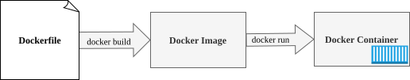
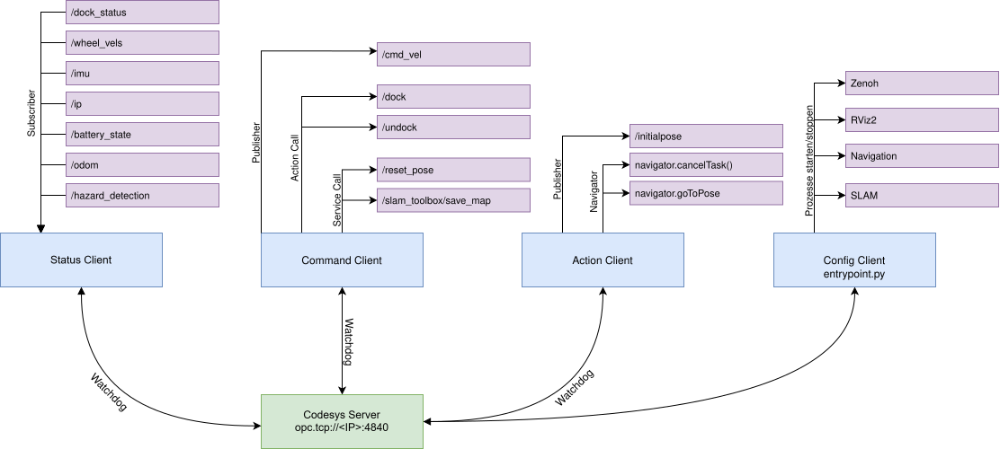
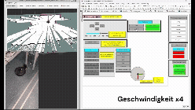

# Steuerung eines TurtleBot4 aus Codesys via OPC UA  
Dieses Repository enthält eine Kommunikationsschnittstelle zwischen einer virtuellen CODESYS-SPS (vSPS) und einem realen TurtleBot 4 Lite auf Basis von OPC UA und ROS 2 Humble. Der Roboter wird vollständig über eine CODESYS-Visualisierung bedient: Sensor- und Zustandsdaten werden an die SPS übertragen, der Roboter wird im Handbetrieb gesteuert oder navigiert autonom mit Nav2 zu vorgegebenen Zielpositionen in einer zuvor mit SLAM erstellten Karte.  

## Aufbau und Installation der Entwicklungsumgebung  
Die ROS 2 Programme laufen in einem Docker-Container unter WSL2. Da WSL2 im NAT-Modus betrieben wird, ist eine direkte DDS-Verbindung zum Roboter im WLAN nicht möglich. Die Verbindung zwischen Container und TurtleBot 4 erfolgt deshalb über die zenoh-bridge-ros2dds.  
  

## Installation und Aufbau der Container
Innerhalb des Dockerfiles werden die Zenoh-Schnittstelle und die TurtleBot-4-Pakete installiert und der `ros2_ws` mit `colcon build` gebaut. Anschließend wird aus dem Dockerfile das Image gebaut und aus dem Image der Container erstellt. Beim Start des Containers wird `entrypoint.py` automatisch ausgeführt.  

#### Dockerfile -> Image
```bash
docker build \
  --build-arg ROS_DISTRO=humble \
  --build-arg ZENOH_VERSION=1.9.0 \
  --build-arg SYSTEM_VERSION=x86_64 \
  -t turtlebot4_projektarbeit:latest \
  .
```
| Parameter | Erklärung |
|---|---|
| `ROS_DISTRO` | ROS 2 Distribution des Basis-Images. Das Projekt wurde mit **Humble** entwickelt. |
| `ZENOH_VERSION` | Version der zenoh-bridge-ros2dds. Verwendet wird **1.9.0**, da mit Version 1.10.0 nicht alle Topics korrekt übertragen wurden. Die Version muss mit der Bridge auf dem TurtleBot 4 übereinstimmen. |
| `SYSTEM_VERSION` | Prozessorarchitektur des Zielsystems: `x86_64` für einen PC, `aarch64` für ARM-Rechner (z. B. Raspberry Pi). |
| `-t` | Name und Tag des Images (`turtlebot4_projektarbeit:latest`). |
| `.` | Build-Kontext: das aktuelle Verzeichnis, in dem das Dockerfile liegt. |

#### Image -> Container
```bash
docker run -it \
  --name tb4_container \
  --hostname ros_container \
  --network=host \
  -e OPC_IP=172.21.225.150 \
  -e DISPLAY=$DISPLAY \
  -v /tmp/.X11-unix:/tmp/.X11-unix \
  turtlebot4_projektarbeit
```
| Parameter | Erklärung |
|---|---|
| `-it` | Startet den Container interaktiv mit Terminal. Die Ausgaben von `entrypoint.py` werden direkt angezeigt. |
| `--name` | Name des Containers (`tb4_container`). Über diesen Namen wird der Container später gestartet und geöffnet. |
| `--hostname` | Hostname innerhalb des Containers (`ros_container`). |
| `--network=host` | Der Container nutzt das Netzwerk des Hosts (WSL2). Dadurch ist die Verbindung zum Zenoh Router auf dem TurtleBot 4 und zum OPC UA Server möglich. |
| `-e OPC_IP` | IP-Adresse des OPC UA Servers (vSPS). Die Umgebungsvariable hat Vorrang vor der Konfigurationsdatei `opc_topic_config.yml`. Die IP-Adresse wird in WSL mit `ip a` ermittelt. |
| `-e DISPLAY` | Teilt dem Container mit, mit welchem Display er sich für grafische Anwendungen (z. B. RViz2) verbindet. |
| `-v /tmp/.X11-unix:/tmp/.X11-unix` | Bindet die Schnittstelle ein, über die der X Server von WSL kommuniziert. |
| `turtlebot4_projektarbeit` | Name des Images, aus dem der Container erstellt wird. |

## Aufbau der Clients
Die SPS ist über vier OPC UA Clients mit ROS 2 verbunden, die im Paket `turtlebot4_pkg` umgesetzt sind. Die Architektur entspricht der Schnittstelle für die Roboterarme. Es ändern sich hauptsächlich die angebundenen ROS 2 Schnittstellen.

| Client | Datei | Richtung | Funktion |
|---|---|---|---|
| **Status Client** | `status_client.py` | ROS 2 → CODESYS | Überträgt Sensor- und Zustandsdaten des TurtleBot 4 an die SPS |
| **Command Client** | `command_client.py` | CODESYS → ROS 2 | Manuelle Steuerung, Andocken, Abdocken und Zurücksetzen der Odometrie |
| **Action Client** | `action_client.py` | CODESYS ↔ ROS 2 | Autonome Navigation mit Nav2 zu Zielpositionen in der Karte |
| **Config Client** | `entrypoint.py` | CODESYS → Container | Startet und stoppt ROS 2 Prozesse (Zenoh-Bridge, RViz2, SLAM, Lokalisierung, Navigation) über Softkeys |

### Status Client
Abonniert die Topics der Create3-Basis und des Raspberry Pi und schreibt die Werte zyklisch in die Struktur `tb4_status` im OPC UA Adressraum. Die Sensor-Topics der Create3 werden mit „Best Effort“ veröffentlicht. Der Client abonniert sie deshalb mit dem QoS-Profil `qos_profile_sensor_data`.

| Topic | Interface | Übertragene Daten |
|---|---|---|
| `/dock_status` | `irobot_create_msgs/msg/DockStatus` | Dock sichtbar, angedockt |
| `/wheel_vels` | `irobot_create_msgs/msg/WheelVels` | Radgeschwindigkeiten in rad/s |
| `/imu` | `sensor_msgs/msg/Imu` | Orientierung, Winkelgeschwindigkeit, Beschleunigung |
| `/ip` | `std_msgs/msg/String` | IP-Adresse des Raspberry Pi |
| `/battery_state` | `sensor_msgs/msg/BatteryState` | Spannung, Temperatur, Ladezustand |
| `/odom` | `nav_msgs/msg/Odometry` | Position und Geschwindigkeit relativ zu `odom` |
| `/hazard_detection` | `irobot_create_msgs/msg/HazardDetectionVector` | Gefahrenmeldungen (Bumper, Klippe, Blockade, Rückfahrlimit, ...) |

### Command Client
Wird über Datenänderungen im Adressraum informiert und setzt die Befehle aus CODESYS in ROS 2 Aufrufe um.

| Schnittstelle | Interface | Funktion |
|---|---|---|
| `/cmd_vel` (Topic) | `geometry_msgs/msg/Twist` | Sollgeschwindigkeit, solange die Freigabe aktiv ist |
| `/undock` (Action) | `irobot_create_msgs/action/Undock` | Selbstständiges Abdocken von der Ladestation |
| `/dock` (Action) | `irobot_create_msgs/action/Dock` | Selbstständiges Andocken an die Ladestation |
| `/reset_pose` (Service) | `irobot_create_msgs/srv/ResetPose` | Setzt die Position im Odometrie-Koordinatensystem auf den Ursprung zurück |

### Action Client
Sendet Zielpositionen aus CODESYS an Nav2 und meldet den Fortschritt der Fahrt alle 0,2 s als Statuscode an die SPS zurück. Zusätzlich wird die Initialposition über das Topic `/initialpose` vorgegeben und eine laufende Navigation kann aus CODESYS abgebrochen werden.

### Config Client
Wird beim Start des Containers automatisch ausgeführt. Die ROS 2 Prozesse werden über Start- und Stop-Variablen vom Typ BOOL in CODESYS gesteuert und als eigene Prozessgruppe gestartet, sodass beim Stoppen alle Unterprozesse beendet werden. Bricht die OPC UA Verbindung ab, versucht der Client sie alle 5 s neu aufzubauen.

## Kartenerstellung mit SLAM aus Codesys:

## Autonome Navigation
Ansteuerung des Roboters aus dem Raum 103 und wieder zurück aus einer Schrittkette aus Codesys.

