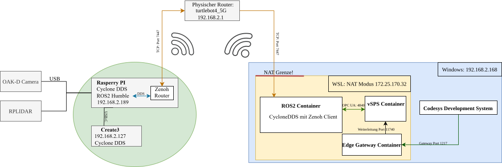
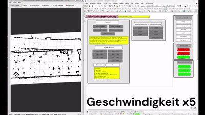

# Steuerung eines TurtleBot4 aus Codesys via OPC UA  
Dieses Repository enthält eine Kommunikationsschnittstelle zwischen einer virtuellen CODESYS-SPS (vSPS) und einem realen TurtleBot 4 Lite auf Basis von OPC UA und ROS 2 Humble. Der Roboter wird vollständig über eine CODESYS-Visualisierung bedient: Sensor- und Zustandsdaten werden an die SPS übertragen, der Roboter wird im Handbetrieb gesteuert oder navigiert autonom mit Nav2 zu vorgegebenen Zielpositionen in einer zuvor mit SLAM erstellten Karte.  

## Aufbau und Installation der Entwicklungsumgebung  
Die ROS 2 Programme laufen in einem Docker-Container unter WSL2. Da WSL2 im NAT-Modus betrieben wird, ist eine direkte DDS-Verbindung zum Roboter im WLAN nicht möglich. Die Verbindung zwischen Container und TurtleBot 4 erfolgt deshalb über die zenoh-bridge-ros2dds.
  

## Kartenerstellung mit SLAM aus Codesys:

